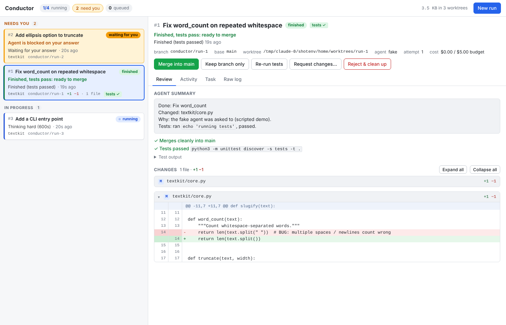

# Conductor

One page to start coding-agent runs, see what each one is doing, and review what they produce.

You give it a git repo and a task. It starts a headless agent (Claude Code) in its own git worktree and keeps the run on a board ranked by what needs you. When the agent finishes, it runs the tests and shows you the diff, the summary and the test result, and you merge or reject. It survives being killed: agents keep working while it's down, and it picks them up again when it comes back.



**Demo video (3½ min):** [docs/demo.mp4](docs/demo.mp4). It covers creating a run, parallel runs, answering a question, review and merge, a same-file conflict handed back to the agent, and `kill -9` of the conductor mid-run.

## Scripted demo

```bash
node scripts/demo.js --interactive        # live demo: press Enter to advance each step
node scripts/demo.js --record docs/demo.mp4 --pace 1.6   # re-record the video (headless)
node scripts/demo.js --agent claude --interactive        # same flow with real Claude Code
```

The script makes a throwaway repo and conductor home under a temp dir, so it never touches your real `~/.conductor`. It needs Node and the `playwright` package; the conductor itself does not.

## Quick start

Requirements: Python ≥ 3.11, git ≥ 2.38 (for `merge-tree --write-tree`), and the `claude` CLI on `PATH` for real runs. There are no pip dependencies.

```bash
./conductor.sh
```

Open http://127.0.0.1:7700. Data lives in `~/.conductor`; override it with `CONDUCTOR_HOME` or `--home`.

To try it without spending tokens, make the sample repo and choose agent **fake** (a scripted agent that really edits files):

```bash
scripts/make-demo-repo.sh /tmp/demo-repo
```

| Fake-agent directive (put it in the task text) | Effect |
|---|---|
| `[[fake:write path]]content[[/fake]]` / `[[fake:append path]]…[[/fake]]` | edit a file |
| `[[fake:ask]]` | ask a question and block until you answer |
| `[[fake:sleep 30]]` | take longer, which is useful for the kill/restart demo |
| `[[fake:fail]]`, `[[fake:hang]]` | fail, or go silent (watchdog) |

Run the tests (about 25 s, all real git and real processes; CI runs them on Python 3.11 and 3.12):

```bash
python3 -m unittest discover -s tests
```

Settings (environment variables): `CONDUCTOR_PORT` (7700), `CONDUCTOR_MAX_PARALLEL` (4), `CONDUCTOR_BUDGET_USD` (5, the per-attempt default), `CONDUCTOR_STALL_SECS` (180), `CONDUCTOR_MAX_RUN_SECS` (3600), `CONDUCTOR_TEST_TIMEOUT_SECS` (600), `CONDUCTOR_CLAUDE_BIN`.

## Field test on a real project

The [more-itertools field test](docs/field-test-more-itertools.md) gave five real Claude Code agents a five-task sprint. The result: 5 of 5 merged and $3.47 spent. To repeat it on your machine, start with the clone:

```bash
git clone https://github.com/more-itertools/more-itertools ~/src/more-itertools
```

Then start the conductor with its own data directory:

```bash
CONDUCTOR_HOME=~/.conductor-fieldtest CONDUCTOR_MAX_PARALLEL=5 ./conductor.sh
```

In a second terminal, create the five runs. They use real Claude Code, about $2 cap each; add `--agent fake` for a run that spends nothing:

```bash
python3 scripts/field-test/create_runs.py ~/src/more-itertools
```

Watch the board at http://127.0.0.1:7700, or in the terminal:

```bash
python3 scripts/field-test/board.py
```

Things to try while it runs:
- `kill -9` the conductor mid-run and start it again.
- Answer questions.
- Review and merge.
- Use **Ask agent to resolve conflicts** when the changelog edits collide.

Merges go only to your local clone's `master`.

## Running a fleet

Conductor is built for a team starting hundreds or thousands of runs: by hand, in batches, from repeatable workflows, and on schedules, spread over many machines.

### Attention at scale
- **Look at these next:** the board opens with the three runs that most need you. Within a tier, the run that has waited longest comes first.
- **Paging and search:** the board is paged and searchable. The attention score is stored and indexed, so the board stays fast at thousands of runs.
- **Groups:** runs created together (a batch, a schedule) collapse into one group with tallies ("38 ready · 2 failing · 1 needs you"). Bulk actions: merge all ready, reject all failed, restart interrupted.
- **Batches:** `POST /api/batches`, or the Batch toggle in New run, creates many runs at once, one per line.

### Guardrails: a policy per repository
A repository commits `.conductor/policy.toml`. Conductor-wide defaults live in `CONDUCTOR_HOME/policy.toml`. Each layer can only tighten the one before it.

```toml
[paths]      allowed = ["src/**", "tests/**"]   forbidden = [".github/**", "secrets/**"]
[diff]       max_files = 20   max_lines = 600   forbid_test_deletion = true
[commands]   forbidden = ["git push", "curl", "wget"]          # built-in: git push, git reset --hard, rm -rf /, sudo
[limits]     max_budget_usd = 5   max_runtime_secs = 3600   max_parallel_per_repo = 20
[merge]      protected_targets = ["main"]   require_approval_over_lines = 300
[violation]  on_forbidden_command = "kill"   on_forbidden_path = "kill"   # or "flag"
```

It is enforced at four points:
1. **At create:** the budget is checked against the cap.
2. **At launch:** forbidden commands and paths become Claude Code's own deny rules, which it applies even with permission prompts skipped. This was verified with a real run.
3. **Live:** every streamed tool call is checked. An executed violation stops the agent; a refused attempt is recorded.
4. **Before merge:** the diff is checked. A blocked merge needs a written override reason, and the override goes to the audit log (`GET /api/audit`).

Agents can never change `.conductor/`, the directory that holds their own policy.

### Repeatable workflows
A workflow is a named chain of steps, defined once in `.conductor/workflows/<name>.toml` and fired at any task. The built-ins are `feature` (implement → add tests → self-review with an approval gate → docs), `bugfix` and `dependency-bump`.

Each step is the next attempt on the same run and branch. A step can require passing tests, stop on failure, or wait at an approval gate.

### Scheduled and triggered runs
- **Cron (UTC):** for example `0 3 * * 1-5`, which is 03:00 on weekdays.
- **On change:** fires when a branch moves.
- **Exactly once:** each fire is claimed with a compare-and-set, so it can't fire twice, even across restarts.
- **After downtime:** catch up once, or skip.
- **No pile-up:** a schedule skips a fire while its previous run is still active.
- **Where to manage them:** the Schedules panel in the UI, or `/api/schedules`.

### Workers on many machines
The coordinator, `./conductor.sh`, keeps every decision. Workers on any machine lease runs, execute them in their own worktrees, stream output back, and push the run branch.

To run a coordinator that executes nothing itself:

```bash
./conductor.sh --max-parallel 0
```

On each worker machine, start a worker pointed at the coordinator:

```bash
python3 -m conductor.worker --coordinator http://coordinator:7700 --token-file ~/.conductor/worker_token --capacity 16
```

Workers on other machines need git access to the repository. Map it with `CONDUCTOR_REPO_REMOTES='{"/srv/repos/app": "ssh://git@host/app.git"}'`. A worker that goes silent is marked lost and its runs are interrupted. A restarted worker re-attaches to its running agents. The protocol is in [docs/api.md](docs/api.md#remote-workers-phase-3).

**Load test:** `python3 scripts/loadtest.py --runs 1000 --workers 4 --capacity 16` kills a worker and the coordinator mid-run, then checks that nothing started twice and no event was lost. Results are in [docs/scale-test.md](docs/scale-test.md).

## Architecture

```
browser ──HTTP/JSON (poll 1.5s)──► server.py ──► service.py ──┐  user actions: create, answer,
                                                              │  accept, reject, restart, cancel
                                                              ▼
                                   SQLite (conductor.db) ◄── supervisor.py (one thread, tick 0.5s)
                                   runs + events                │ spawns (setsid)
                                                                ▼
                                                  runner.py ──► claude -p --output-format stream-json
                                                  (detached)    cwd = ~/.conductor/worktrees/run-N
                                                                stdout → runs/run-N/attempt-K/stream.jsonl
```

| File | Responsibility |
|---|---|
| `conductor/states.py` | The state machine (legal transitions) and attention ranking. |
| `conductor/db.py` | SQLite store. Every state change is a compare-and-set. Stream ingestion advances a byte offset in the same transaction as the events. |
| `conductor/supervisor.py` | Scheduling, launching, monitoring, finishing attempts, running tests, watchdog, merge-check refresh, janitor. |
| `conductor/runner.py` | Tiny detached parent of the agent. Writes `runner.json` (pid) and `exit.json` (exit code). |
| `conductor/service.py` | User operations, each one locked per run and done as a compare-and-set. |
| `conductor/gitops.py` | Worktrees, diffs, merge checks, merges, conflict-marker guard. |
| `conductor/agents/` | Agent adapters (`claude`, `fake`), the stream-json parser that produces the "what is it doing" line, and the unattended-mode prompt. |
| `conductor/static/` | The UI: vanilla JS, no build step. |
| `docs/api.md` | HTTP API contract. |

### Run lifecycle

`queued → starting → running → testing → finished → accepted | rejected`

There are also `waiting_input` (the agent asked a question), `failed`, `interrupted` (its process vanished) and `cancelled`.

The full table is in `conductor/states.py`. Every move goes through `Store.transition(id, from_states, to)`, an atomic `UPDATE … WHERE state IN (…)`. That makes a double-clicked Accept, two browser tabs, or a restart racing the scheduler harmless: only one caller can win.

### How the questions in the brief are answered

**Status without reading the log.** The status line comes from the agent's stream-json: tool calls ("Editing textkit/core.py", "Running: pytest -q"), Claude's own `task_summary` progress lines, and the first line of its messages. No extra LLM call is made. The board is sorted by *attention*:

1. Blocked on you.
2. Ready to merge.
3. Conflicts or failing tests.
4. Failed or interrupted.
5. Wedged (no output for a while).
6. Everything that's just working.

The tab title shows `(N) Conductor`.

**Blocked on a question.** A headless agent can't prompt. So every run gets a system prompt that says: if you need a human decision, end with `QUESTION: …` and stop. The conductor detects this and moves the run to `waiting_input` at the top of the board, with an answer box. Your answer resumes the *same* agent session (`claude --resume <session>`) in the same worktree, so the agent picks up where it left off.

**Isolation.** Each run gets its own worktree under `~/.conductor/worktrees/run-N` on branch `conductor/run-N`, cut from the chosen base branch.

**Review.** When the agent exits, the conductor:

1. Commits whatever it left. Build junk such as `__pycache__` and `node_modules` is never committed, even in repos without a `.gitignore`.
2. Runs the repo's tests itself, from the test command you gave or one it auto-detects. It doesn't trust the agent's own claim that the tests pass.
3. Computes the diff and a merge check against the *current* target branch.

You can then:

- **Merge**: a `--no-ff` merge into the target.
- **Keep branch only**: the worktree is removed and the branch stays for you to merge.
- **Reject**: the worktree and branch are deleted.
- **Request changes**: your feedback goes to the same session.

**Two runs editing the same file.**

1. *While they run*, each card shows "also editing x.py: #3". This is computed from each worktree's changed files every few seconds.
2. *After the first is merged*, the second's merge check is recomputed, because the target moved. It turns "conflicts with main", Merge is disabled, and **Ask agent to resolve conflicts** appears. That merges main into the run's branch, hands the conflicted files to the same agent session, then re-tests. The review diff is taken from the merge-base with main, so it still shows only the run's own change.
3. A merge is also refused if the branch still contains `<<<<<<<`/`>>>>>>>` markers. Git would happily merge those "cleanly"; this check caught a real case during development.

The merge never runs in your working copy unless the target branch is checked out there and it is clean. Otherwise the merge commit is built with `git merge-tree` / `commit-tree` and the branch is moved with `update-ref` (compare-and-swap).

**Restart.**

- The agent is *not* a child holding a pipe to the conductor. It runs under a detached `runner.py` that writes its stdout to a file and its exit code to `exit.json`.
- Kill the conductor (even with `kill -9`) and the agents keep working.
- On start, the supervisor re-attaches. It tails each stream from the stored offset and checks that the runner pid is alive *and* is our runner for that attempt; the command-line check guards against pid reuse. If the runner finished meanwhile, the result is processed normally.
- If the runner is gone with no exit code (reboot, killed), the run is marked **interrupted** with a Restart button. Restart resumes the agent's session.
- A run caught mid-launch is also marked interrupted. Nothing is ever relaunched automatically, so no run starts twice.

**Cleanup.** Accept, reject and cancel remove the worktree and the run's branch (unless you kept it). A janitor runs at startup and every 5 minutes. It deletes any worktree under `~/.conductor/worktrees` whose run is finished or unknown, and runs `git worktree prune` on every known repo. Disk use of the live worktrees is shown in the header. Transcripts (`stream.jsonl`) are kept as records; they are small.

**Reaching you.** Click **Notify me** once. After that, you get a desktop notification only when a run *newly* needs you (a question, ready to merge, failed) and the tab isn't focused. Nothing else notifies. Clicking the notification opens that run.

**Budgets and watchdog.** The budget is per run (default $5). Each attempt gets what's left via `--max-budget-usd`, and a run that has spent it all won't start again. Cost is shown per run. A run with no output for `CONDUCTOR_STALL_SECS` is flagged "may be wedged" and ranked up. One past `CONDUCTOR_MAX_RUN_SECS` is killed and marked failed.

## Trade-offs

- **Stdlib Python + SQLite + polling.** There's nothing to install, and one process is easy to reason about. Polling every 1.5 s is plenty for a handful of runs. At scale I'd switch to SSE or websockets.
- **Agents outlive the conductor.** This is better for the user (no lost work), but it means a conductor that is down for a long time has agents running unsupervised. The budget cap still applies, and the watchdog catches up on restart.
- **Questions via a text convention.** It works with any headless agent. The cost is that it relies on the agent following the instruction. If it asks a question in prose without the marker, the run ends as "finished" and the summary shows the question.
- **The conductor commits for the agent**, so a run's result is always "the branch". The commit messages are generic.
- **Tests run on the run's branch, not on the merge result.** The merge check covers textual conflicts, not semantic ones. Re-testing after the target moves is a manual "Re-run tests".
- **Single user, single machine, localhost only.** POSTs check `Origin` to block cross-site requests, but there is no auth.

See [docs/decisions.md](docs/decisions.md) for what was left out and what changes at 10× scale.
